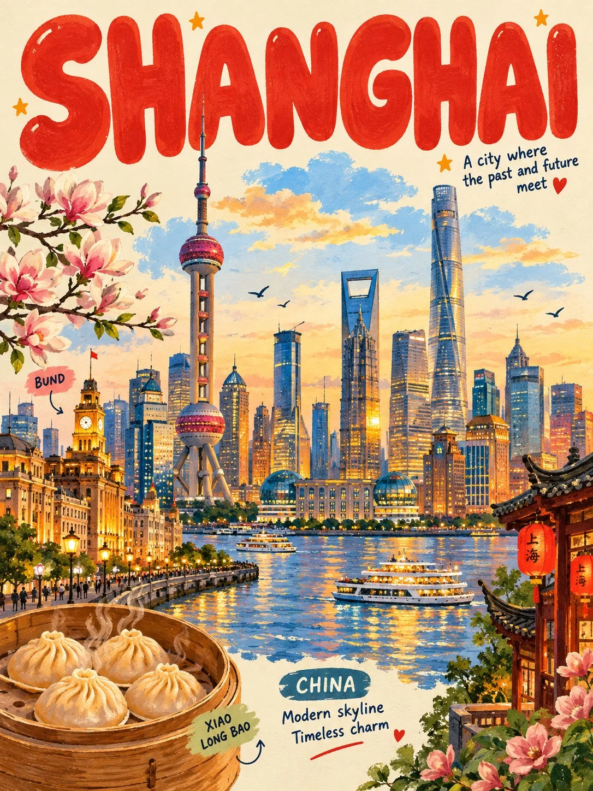

# Bubble-Letter Stationery Travel Poster

**中文标题：** 气泡字文具风旅行海报  
**ID:** `gi25-x-865` · **Mode:** `generate`  
**Categories:** `poster-typography`  
**Tags:** `x-twitter`, `community`, `gpt-image-2.5`, `x-direct`, `en`



### Bubble-Letter Stationery Travel Poster

```text
Create a cute, playful 3:4 vertical illustrated poster of [COUNTRY / CITY / LOCATION / SUBJECT], featuring bold bubble lettering, charming hand-painted illustrations, and a colorful stationery-brand aesthetic.

MAIN SUBJECT: Make the main subject large and instantly recognizable, preserving its defining shape, colors, patterns, and distinctive details. Automatically adapt the illustration to the subject, whether it is food, a product, an animal, a person, a character, or a landscape.

TYPOGRAPHY: Place a huge, chunky, rounded English title across the top, filled with one vibrant accent color. Add a small rounded label and a short playful caption near the bottom. Keep all lettering bold, readable, and naturally arranged.

ILLUSTRATION STYLE: Soft opaque gouache and oil-pastel textures, rounded shapes, expressive details, gentle painted highlights, and subtle handmade imperfections. Keep the main subject beautifully illustrated rather than photorealistic.

DECORATIONS: Add 4–6 small, subject-specific doodles around the main illustration. Choose meaningful objects, symbols, plants, or accessories that complement the subject. Include a small speech bubble only when appropriate.

COLOR & LAYOUT: Use a bright, warm cream background with a vibrant title color and 2–3 complementary accent colors. Keep the composition full and lively but balanced, with generous spacing and no overlapping elements that obscure the subject.

FINAL AESTHETIC: Whimsical collectible art print, bold hand-drawn bubble typography, tactile painted textures, playful editorial design, and cohesive color harmony.

AVOID: White sticker outlines, double borders, excessive doodles, rough scribbling, glossy 3D rendering, vector-flat graphics, clutter, illegible text, logos, and watermarks.

FORMAT: Full-frame 3:4 portrait. Text-to-image only; generate the entire artwork creatively from the subject description, without requiring a reference image.
```

- **Recommended model:** `gpt-image-2.5-sunburst`
- **Settings:** _(defaults)_
- **Source:** [community](https://x.com/Goodmanprotocol/status/2110939679407427733) — @Goodmanprotocol
- **License note:** Original public X post; quoted with attribution — remix with attribution
- **Notes:** Collected directly from X; original post https://x.com/Goodmanprotocol/status/2110939679407427733; post text names GPT Image 2.5; discovered via X search, prompt re-verified against the original X post via api.fxtwitter.com; verified=True
- **Preview:** `previews/gi25-x-865.webp`
