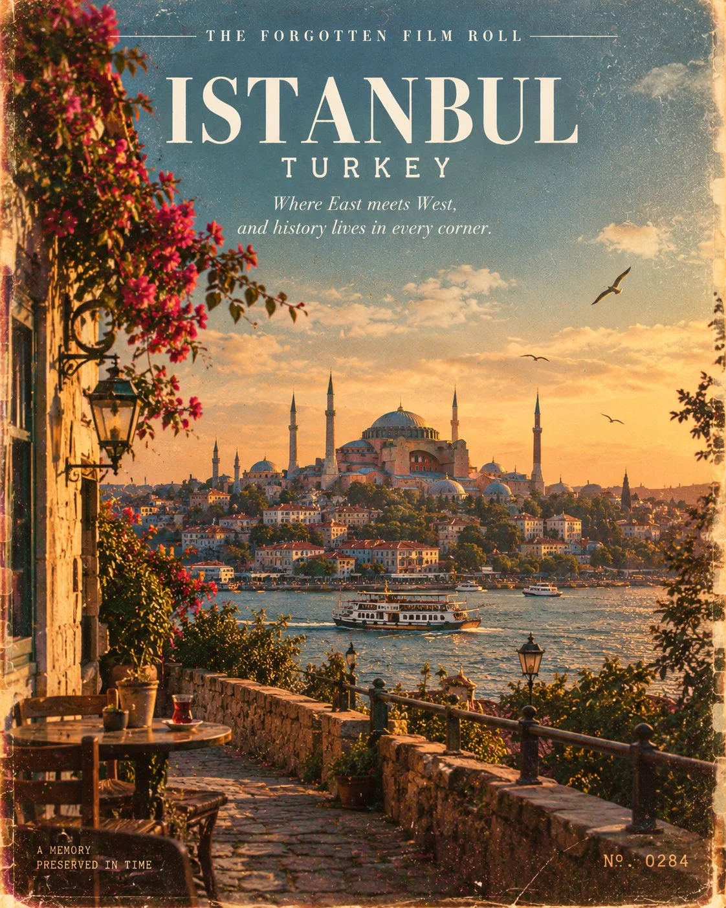

# 1970s 35mm Vintage Travel Magazine Cover

**中文标题：** 1970 年代 35mm 复古旅行杂志封面  
**ID:** `gi25-x-868` · **Mode:** `generate`  
**Categories:** `poster-typography`  
**Tags:** `x-twitter`, `community`, `gpt-image-2.5`, `x-direct`, `en`



### 1970s 35mm Vintage Travel Magazine Cover

```text
Create a stunning vintage travel magazine cover featuring [LANDMARK], [CITY], [COUNTRY], photographed as if captured on a forgotten 35mm film roll in the 1970s.

Show the landmark in its authentic real-world setting, preserving its exact architectural design, proportions, original colors, and historical details. Capture an unposed, natural moment with warm afternoon sunlight, gently weathered walls, old streets, subtle greenery, and a few locals in the distance. The atmosphere should feel like a genuine memory from another era, not a staged tourist photograph.

VISUAL AESTHETIC:
Authentic 1970s analog film photography, faded olive green, warm sepia, dusty terracotta, muted golden yellow, natural shadows, subtle film grain, slight light leaks, imperfect exposure, and beautifully aged photographic textures. Add delicate imperfections that make the image feel real, nostalgic, and timeless.

MAGAZINE COVER DESIGN:
Place the landmark as the main visual, with elegant, understated vintage editorial typography.

At the top, write:
“THE FORGOTTEN FILM ROLL”

Below it, display the location in refined uppercase typography:
“[CITY], [COUNTRY]”

Add the landmark’s name in a smaller, sophisticated typeface:
“[LANDMARK]”

At the bottom, include a poetic historical tagline:
“Some places never leave the past. They carry it into forever.”

Add a small archival-style date stamp reading “A MEMORY PRESERVED IN TIME” and subtle photographic numbering to evoke an authentic vintage print.

Keep the layout artistic, minimal, sophisticated, and beautifully balanced. Typography must be clean and legible, with correct spelling. Avoid excessive text, fantasy elements, oversaturated colors, artificial architecture, and overly polished AI aesthetics.

Overall feeling: A forgotten travel photograph rediscovered decades later—where history, architecture, and memory exist in a single frame.

Aspect ratio: 4:5 vertical. High-detail, photorealistic, timeless editorial photography.
```

- **Recommended model:** `gpt-image-2.5-sunburst`
- **Settings:** _(defaults)_
- **Source:** [community](https://x.com/Naiknelofar788/status/2110958934144217161) — @Naiknelofar788
- **License note:** Original public X post; quoted with attribution — remix with attribution
- **Notes:** Collected directly from X; original post https://x.com/Naiknelofar788/status/2110958934144217161; post text names GPT Image 2.5; discovered via X search, prompt re-verified against the original X post via api.fxtwitter.com; verified=True
- **Preview:** `previews/gi25-x-868.webp`
