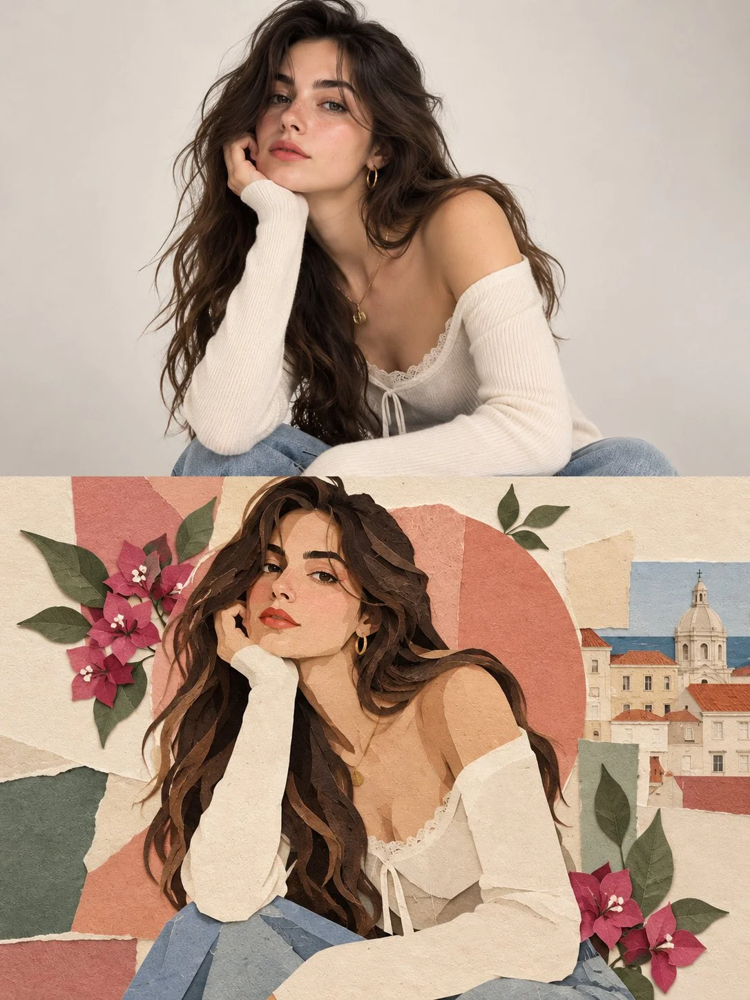

# Photo + Paper-Art Split Editorial Poster Series

**中文标题：** 照片+纸艺上下分屏编辑海报系列  
**ID:** `gi25-x-879` · **Mode:** `edit`  
**Categories:** `poster-typography`, `edit-change-preserve`  
**Tags:** `x-twitter`, `community`, `gpt-image-2.5`, `x-direct`, `en`



### Photo + Paper-Art Split Editorial Poster Series

```text
Create a collection of individual, high-end editorial art posters, producing one separate design for every uploaded photograph. Treat each image as its own creative project, with no image merging, repeated layouts, or borrowed design elements between posters.

CANVAS & STRUCTURE: Use a strict 3:4 vertical format with a precise 50/50 horizontal division. The upper section must retain the original photograph, including the subject’s face, identity, pose, clothing, defining details, original color relationships, and natural lighting. Apply only restrained tonal refinement for a polished magazine finish. Do not reconstruct, reshape, or replace the photographed subject.

PHOTOGRAPHIC UPPER PANEL: Preserve the authentic image as the visual anchor. Simplify distracting surroundings only where necessary, without altering the subject or compromising the photograph’s original character.

LOWER PANEL — PAPER SCULPTURE: Reinterpret the subject’s defining features, silhouette, or visual story as a contemporary handcrafted paper composition. Build the artwork from bold cutouts, abstract contours, overlapping cardstock, and carefully arranged geometric fragments. Reduce unnecessary details while retaining recognizable visual connections to the original photograph. The result should feel like an art director’s handcrafted mixed-media experiment, not a cartoon illustration.

LAYOUT & SPATIAL DESIGN: Create a striking contrast between a spacious, pale upper field and a confidently colored lower section extending edge to edge. Let the subject interact visually with the dividing line, creating a seamless relationship between photography and collage. Introduce an off-center shape, architectural color panel, or restrained graphic accent only when it strengthens the composition. Keep the arrangement intentional, airy, and visually distinctive.

PALETTE & MATERIALS: Derive a small selection of complementary colors from the source image, then translate them into luminous, understated pastel tones. Combine matte paper surfaces, fine fibrous grain, slightly irregular cut edges, and delicate overlapping layers. Establish dimension through the arrangement of paper elements rather than pronounced shadows, gradients, or artificial depth.

EDITORIAL FINISH: Use typography sparingly. If suitable, include a small art-publication title, discreet caption, or minimal typographic detail, positioned with precision. Avoid unnecessary text, decorative labels, and oversized lettering.

ARTISTIC DIRECTION: Contemporary gallery poster meets independent art-journal design. Balance photographic authenticity with tactile paper craftsmanship, bold color blocking, thoughtful asymmetry, and generous breathing room. Every poster should have its own visual character, derived directly from its source photograph.

STRICT EXCLUSIONS: No combined photographs, duplicated designs, distorted anatomy, altered facial identity, full-scene illustration, cartoon rendering, glossy 3D elements, excessive drop shadows, gradients, busy backgrounds, or mass-produced template aesthetics.

FINAL OBJECTIVE: Produce a refined, collectible-quality editorial poster that feels individually art-directed. The original photograph remains authentic in the upper half, while the lower half translates its visual identity into a fresh, tactile, minimalist paper-art interpretation.
```

- **Recommended model:** `gpt-image-2.5-sunburst`
- **Settings:** _(defaults)_
- **Source:** [community](https://x.com/j_smeaton99/status/2111755839895699812) — @j_smeaton99
- **License note:** Original public X post; quoted with attribution — remix with attribution
- **Notes:** Collected directly from X; original post https://x.com/j_smeaton99/status/2111755839895699812; post text names GPT Image 2.5; discovered via Bin0754/gpt-image-gallery index, prompt re-verified against the original X post via api.fxtwitter.com; verified=True
- **Preview:** `previews/gi25-x-879.webp`
