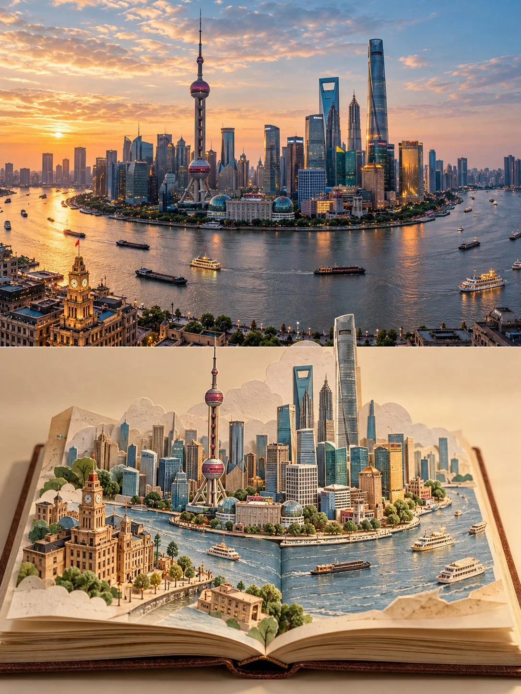

# Photo + Papercraft Travel-Memory Split Poster

**中文标题：** 实拍+纸艺旅行记忆分屏海报  
**ID:** `gi25-x-882` · **Mode:** `edit`  
**Categories:** `poster-typography`, `edit-change-preserve`  
**Tags:** `x-twitter`, `community`, `gpt-image-2.5`, `x-direct`, `en`



### Photo + Papercraft Travel-Memory Split Poster

```text
Create a 3:4 vertical travel-memory poster using [LOCATION / DESTINATION / SUBJECT] as the only scene reference.

COMPOSITION:
Divide the image into two equal horizontal halves.

TOP HALF — REAL PHOTOGRAPH:
Preserve the original photograph as faithfully as possible, retaining recognizable architecture, natural proportions, perspective, lighting, shadows, and environmental details. Allow only subtle color correction and necessary cropping. Do not redesign or invent elements.

BOTTOM HALF — POP-UP PAPER WORLD:
Show a real open travel journal against a warm ivory background, with visible page thickness, a defined spine, gently curled corners, and tactile paper texture. Reconstruct the photograph’s most distinctive landmarks and environmental features as a miniature three-dimensional paper-cut scene rising from the pages. Use delicate architectural linework, restrained pastel coloring, layered cutouts, folded paper, realistic occlusion, and natural contact shadows.

TRANSITION:
Connect both halves organically using elements from the actual location, such as a river flowing into the book, a street continuing across the spine, or trees transforming into layered paper shapes. Make the transition feel spatially continuous rather than like a collage.

STYLE:
A sophisticated blend of authentic photography, handcrafted paper engineering, and minimalist travel-journal artistry. Preserve the destination’s identity and create the feeling of collecting a real place inside a book.

Avoid turning the photograph into an illustration, flattening the paper scene, distorting landmarks, adding unrelated objects, excessive decoration, titles, readable text, or watermarks.

FORMAT: 3:4 vertical, exact 50/50 horizontal split.
```

- **Recommended model:** `gpt-image-2.5-sunburst`
- **Settings:** _(defaults)_
- **Source:** [community](https://x.com/Goodmanprotocol/status/2111773880247550136) — @Goodmanprotocol
- **License note:** Original public X post; quoted with attribution — remix with attribution
- **Notes:** Collected directly from X; original post https://x.com/Goodmanprotocol/status/2111773880247550136; post text names GPT Image 2.5; discovered via Bin0754/gpt-image-gallery index, prompt re-verified against the original X post via api.fxtwitter.com; verified=True
- **Preview:** `previews/gi25-x-882.webp`
