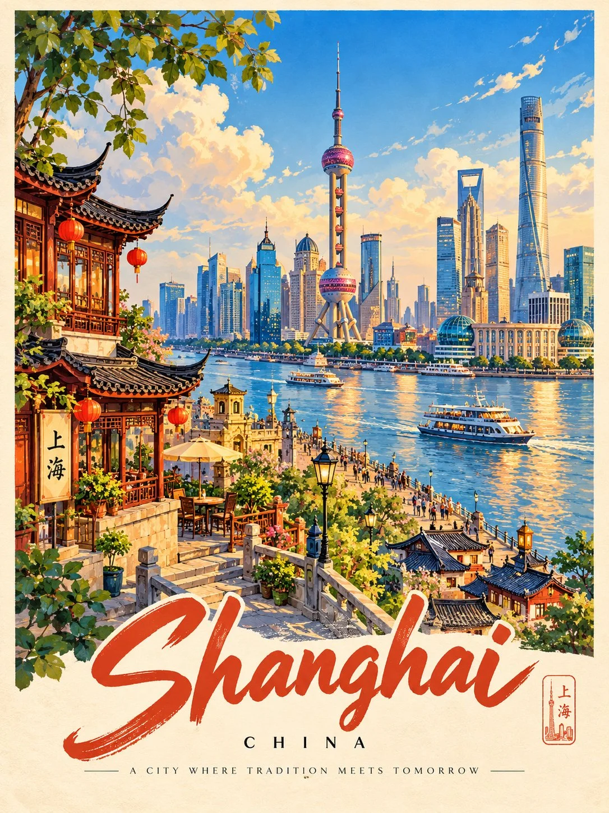

# Storybook Vintage Travel Poster

**中文标题：** 绘本风复古旅行海报  
**ID:** `gi25-x-883` · **Mode:** `generate`  
**Categories:** `poster-typography`  
**Tags:** `x-twitter`, `community`, `gpt-image-2.5`, `x-direct`, `en`



### Storybook Vintage Travel Poster

```text
Create a charming 3:4 vertical vintage travel poster of [COUNTRY / CITY / DESTINATION], illustrated in a colorful, storybook-inspired style.

SCENE:
Show one iconic location with instantly recognizable landmarks, distinctive architecture, beautiful scenery, and authentic local details. Arrange the scene with an elevated viewpoint, layered depth, winding canals or streets, and a few lively elements that capture the destination’s character. Adapt the composition naturally to the location.

ART STYLE:
Clean hand-painted illustration with elegant outlines, simplified architectural details, rich colors, and a polished vintage travel-poster aesthetic. Make the scene whimsical, inviting, and richly detailed without looking photorealistic.

COLORS & LIGHT:
Use a harmonious palette of turquoise, sky blue, warm cream, coral, terracotta, golden yellow, and leafy green, adapted to the destination. Add soft clouds, warm sunlight, and a beautiful atmosphere.

POSTER DESIGN:
Frame the illustration with a subtle cream border. At the bottom, feature the destination’s name in large, elegant brush lettering, followed by the country in small uppercase letters and a short poetic travel-inspired tagline.

Keep the landmark as the focal point, with balanced composition, crisp details, and a collectible vintage postcard finish. Ensure all lettering is correctly spelled and readable.

Avoid photorealism, clutter, excessive decoration, distorted landmarks, illegible text, watermarks, and logos.

FORMAT: 3:4 vertical, full poster composition.
```

- **Recommended model:** `gpt-image-2.5-sunburst`
- **Settings:** _(defaults)_
- **Source:** [community](https://x.com/Goodmanprotocol/status/2111372178461540580) — @Goodmanprotocol
- **License note:** Original public X post; quoted with attribution — remix with attribution
- **Notes:** Collected directly from X; original post https://x.com/Goodmanprotocol/status/2111372178461540580; post text names GPT Image 2.5; discovered via Bin0754/gpt-image-gallery index, prompt re-verified against the original X post via api.fxtwitter.com; verified=True
- **Preview:** `previews/gi25-x-883.webp`
