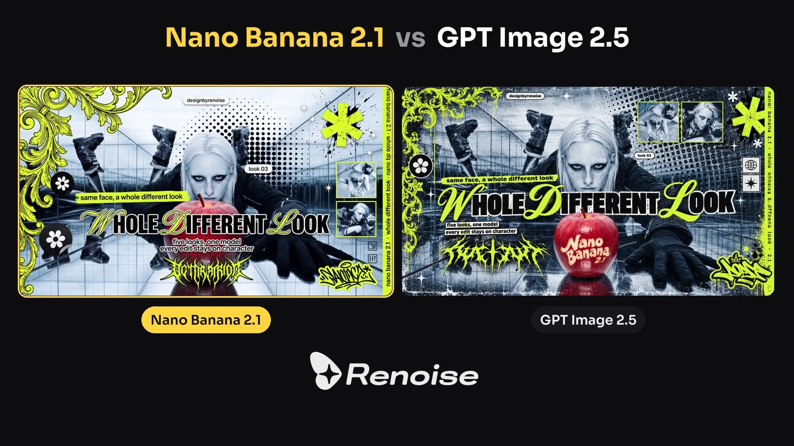

# Grunge Y2K K-pop Collage Poster from Reference

**中文标题：** 参考图→Grunge Y2K K-pop 拼贴海报  
**ID:** `gi25-x-890` · **Mode:** `edit`  
**Categories:** `poster-typography`, `edit-change-preserve`  
**Tags:** `x-twitter`, `community`, `gpt-image-2.5`, `x-direct`, `en`



### Grunge Y2K K-pop Collage Poster from Reference

```text
Design a 16:9 landscape grunge Y2K K-pop collage poster from reference image 1. Layout job: the model, her pose, face, smoky eyes, hair, outfit, gloved hand and the apple stay exactly as in reference image 1, same position and size. Reference images 2 and 3 are other photos of the same model, used only as two tiny inset photos.
Color system: convert the whole photo, including her and the mirror room, into a cold icy blue-gray duotone, like a cyanotype photocopy with crushed blacks, heavy grain and slight print blur. Keep only the apple in its true red so it is the single warm spot. The only accent color is acid lime-yellow, plus black and white.
Elements:
Top-left corner and down the left edge: ornate baroque filigree scrollwork in acid lime, rough and printed.
A large field of black halftone dots on the right half, fading from big dots to small, behind her shoulder.

Across the middle of the poster, crossing in front of her body but never over her face or the apple: a big bold black headline with white outline: “WHOLE DIFFERENT LOOK”, where the W, D and L are swapped for lime script capitals.
Directly above the headline, a lime highlighter strip with black lowercase text: “same face, a whole different look”.
Under the headline, two lines of small white-outlined black lowercase text: “five looks, one model” / “every edit stays on character”.
Below the headline, a spiky lime gothic tribal calligraphy splat, and another lime graffiti tag sticker at the bottom right.
A big lime asterisk sticker with black ink splatter at the top right, a few small white asterisk sparkles.
Small white pill tags with black text: “designbyrenoise” near the top, “look 03” beside her head.
Two tiny square inset photos on the right, from reference images 2 and 3, also in the icy blue duotone with a thin lime frame.
A round black badge with a white flower icon on the left, and two small black line icons in boxes at the right edge.
Down the right edge, a vertical lime band with tiny black vertical text: “nano banana 2.1 · whole different look · nano banana 2.1”.
Keep the bottom-left corner clear for a logo. Every letter spelled exactly as written, crisp and legible. No other text, no watermark.
```

- **Recommended model:** `gpt-image-2.5-sunburst`
- **Settings:** _(defaults)_
- **Source:** [community](https://x.com/renoiseai/status/2110945335811940564) — @renoiseai
- **License note:** Original public X post; quoted with attribution — remix with attribution
- **Notes:** Collected directly from X; prompt posted as the author's reply https://x.com/renoiseai/status/2110945335811940564 to https://x.com/renoiseai/status/2110943252878909466, which carries the images and names GPT Image 2.5; discovered via Bin0754/gpt-image-gallery index, prompt re-verified against the original X post via api.fxtwitter.com; verified=True; original post compares this same prompt across GPT Image 2.5 and another model; the quoted on-image caption text is part of the author's prompt
- **Preview:** `previews/gi25-x-890.webp`
