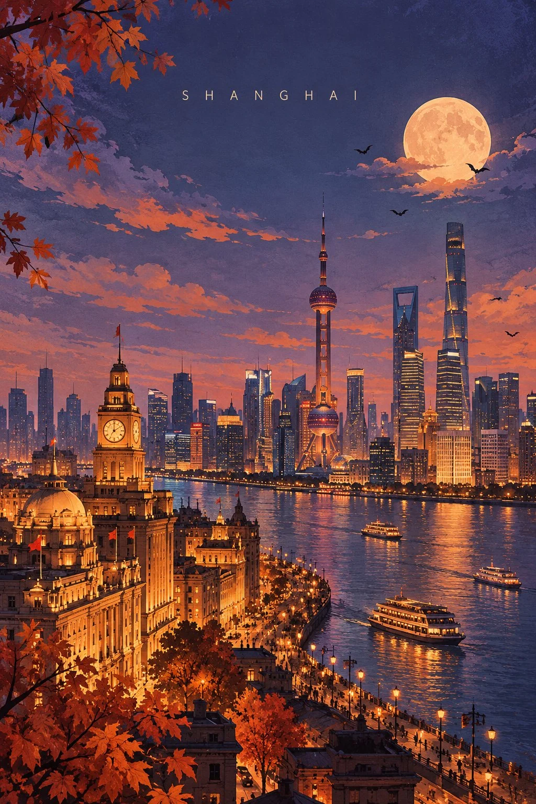

# Halloween Geometric Travel Art Poster Template

**中文标题：** 万圣节几何旅行艺术海报模板  
**ID:** `gi25-x-909` · **Mode:** `generate`  
**Categories:** `poster-typography`  
**Tags:** `x-twitter`, `community`, `gpt-image-2.5`, `x-direct`, `en`



### Halloween Geometric Travel Art Poster Template

```text
DESTINATION: [DESTINATION]

Create a sophisticated Halloween-edition geometric travel art poster of [DESTINATION]. Vertical 2:3, high-resolution, museum-quality editorial illustration.

CORE PRINCIPLE
70% recognizable landmark and authentic cityscape, 30% geometric abstraction. Select one or two iconic landmarks as the unmistakable focal points, preserving their real silhouettes, architectural proportions and distinctive details. Simplify surrounding rooftops, streets, bridges, hills and foliage into elegant geometric color fields.

COMPOSITION
Reserve the upper 40–50% for an expansive, atmospheric twilight sky. Place only “[DESTINATION]” in small, widely spaced uppercase sans-serif lettering near the upper center. Arrange the authentic cityscape across the lower half with graceful architectural layering, compelling depth and a clear focal landmark.

HALLOWEEN ATMOSPHERE
Transform the city into an enchanting, subtly haunted autumn evening, not a horror scene. Use a dusky lavender-blue sky, a softly glowing harvest moon, a few tiny flying bats, delicate drifting clouds, copper-orange autumn leaves and warm amber lights shining through historic windows. Introduce gentle mystery, romantic twilight and understated cinematic magic. Adapt the seasonal details to the destination's actual architecture and geography. Halloween elements must remain secondary to the recognizable city.

GEOMETRIC ART DIRECTION
Blend Scandinavian editorial illustration, mid-century geometric design and refined architectural gouache painting. Use restrained arches, semicircles, rectangular planes and layered silhouettes as supporting compositional accents, never overwhelming the landmarks. Preserve an elegant balance of detailed architecture and simplified geometry.

COLOR & TEXTURE
Limit the palette to 6–10 harmonious colors: dusty periwinkle, muted violet, midnight navy, terracotta, burnt orange, pale peach, soft ivory and warm amber. Add subtle handmade gouache, dry-brush, colored-pencil and fine paper-fiber textures. Crisp, refined museum-print quality, not glossy vector art.

MOOD
Poetic, atmospheric, quietly magical, mysterious, romantic, sophisticated, collectible Halloween travel art.

AVOID
Generic fantasy architecture, distorted landmarks, oversized pumpkins, cartoon ghosts, witches, skeletons, horror imagery, excessive bats, neon orange, heavy black shadows, giant geometric circles, photorealism, 3D rendering, childish illustration, sepia filters, yellowed paper, decorative borders, logos, slogans and extra text.

FINAL TEST
The viewer should recognize [DESTINATION] immediately, then discover the subtle Halloween magic. The result must feel like a contemporary fine-art travel poster rather than a Halloween party advertisement.
```

- **Recommended model:** `gpt-image-2.5-sunburst`
- **Settings:** _(defaults)_
- **Source:** [community](https://x.com/Goodmanprotocol/status/2112410576509087808) — @Goodmanprotocol
- **License note:** Original public X post; quoted with attribution — remix with attribution
- **Notes:** Collected directly from X; original post https://x.com/Goodmanprotocol/status/2112410576509087808; post text names GPT Image 2.5; discovered via X search, prompt re-verified against the original X post via api.fxtwitter.com; verified=True
- **Preview:** `previews/gi25-x-909.webp`
