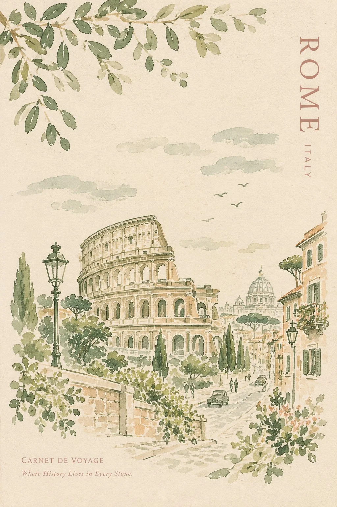

# Vintage Watercolor Travel Journal Cover Template

**中文标题：** 复古水彩旅行手账封面模板  
**ID:** `gi25-x-910` · **Mode:** `generate`  
**Categories:** `poster-typography`  
**Tags:** `x-twitter`, `community`, `gpt-image-2.5`, `x-direct`, `en`



### Vintage Watercolor Travel Journal Cover Template

```text
Create a beautiful, minimalist vintage travel journal cover titled “[CITY, COUNTRY]”, featuring the iconic landmark of [LANDMARK NAME].

Illustrate the destination in a delicate, hand-painted style using loose watercolor brushstrokes and expressive ink sketches. Include the landmark surrounded by recognizable local architecture, charming streets, trees, cultural details, and subtle elements of everyday life that capture the unique character of the place.

Art style: French vintage travel illustration, imperfect watercolor washes, loose botanical sketches, delicate ink lines, and an authentic handmade aesthetic.

Color palette: Muted sage green, olive green, soft eucalyptus, warm ivory, pale beige, and subtle dusty pastel accents. Keep the colors natural, harmonious, and understated.

Composition: Portrait-oriented travel journal cover on warm ivory paper, with the landmark as the central focal point. Leave generous negative space around the illustration, add softly scattered clouds and loosely painted foliage, and allow some brushstrokes to remain unfinished for an authentic artistic feel.

Typography: Display the destination name, “[CITY / COUNTRY]”, vertically along one edge in elegant, understated lettering. Add a small vintage inscription at the bottom, such as “Carnet de Voyage”, along with a beautiful historical tagline: “Where History Lives in Every Stone.”

Texture and finish: Matte paper grain, subtle vintage imperfections, delicate watercolor bleeding, fine ink details, and the appearance of a hand-painted illustration on a premium French stationery cover.

Overall mood: Nostalgic, peaceful, artistic, timeless, and sophisticated—like a treasured travel diary discovered in an old Parisian bookshop.

Important: Preserve the landmark’s authentic architectural features and recognizable proportions. Avoid photorealism, 3D effects, glossy digital finishes, oversaturated colors, heavy outlines, and excessive detail. The final image should look naturally hand-painted, with a clean, elegant composition and a genuine vintage travel-journal Asthetic
```

- **Recommended model:** `gpt-image-2.5-sunburst`
- **Settings:** _(defaults)_
- **Source:** [community](https://x.com/Naiknelofar788/status/2112390343023042585) — @Naiknelofar788
- **License note:** Original public X post; quoted with attribution — remix with attribution
- **Notes:** Collected directly from X; original post https://x.com/Naiknelofar788/status/2112390343023042585; post text names GPT Image 2.5; discovered via X search, prompt re-verified against the original X post via api.fxtwitter.com; verified=True
- **Preview:** `previews/gi25-x-910.webp`
