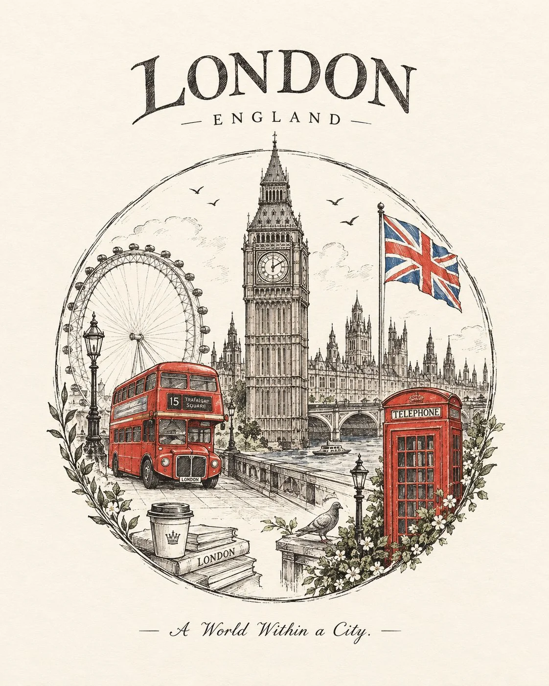

# Circular Ink Travel Emblem Illustration

**中文标题：** 圆形钢笔淡彩旅行徽章插画  
**ID:** `gi25-x-921` · **Mode:** `generate`  
**Categories:** `poster-typography`  
**Tags:** `x-twitter`, `community`, `gpt-image-2.5`, `x-direct`, `en`



### Circular Ink Travel Emblem Illustration

```text
Create a beautiful, vintage-inspired hand-drawn illustration titled “[CITY / COUNTRY / LANDMARK]”, designed as a circular travel emblem on a clean, warm-white background.
Composition: Draw one large, slightly imperfect circle using loose black ink strokes. Inside the circle, create an artistic miniature world representing [CITY / COUNTRY / LANDMARK], combining its most iconic architecture, cultural symbols, local transportation, and recognizable everyday details into one harmonious composition.
Include 3–5 recognizable elements, arranged naturally with overlapping architectural sketches, delicate perspective lines, tiny flying birds, and subtle decorative foliage.
Art style: Handmade pen-and-ink illustration, vintage travel journal, rough architectural sketching, fine cross-hatching, imperfect outlines, and an authentic artist-drawn appearance.
Color palette: Keep most of the illustration in black, white, and soft graphite grey. Selectively fill only a few signature elements with the destination's most recognizable colors, creating beautiful pops of color against the monochrome sketches.
Typography: Place the destination's name above the circle in beautiful, distinctive lettering that complements its cultural identity. Add a small, elegant tagline beneath the illustration.

Keep the composition minimal, balanced, and sophisticated, with generous empty space around the artwork. Every object should feel intentionally placed, like a collectible piece of handmade travel art.
Important: No photorealism, no 3D, no gradients, no busy backgrounds, no excessive colors, and no unnecessary text. Preserve the charm of imperfect hand-drawn lines.
Aspect ratio: 4:5, portrait format, high-quality editorial illustration.
```

- **Recommended model:** `gpt-image-2.5-sunburst`
- **Settings:** _(defaults)_
- **Source:** [community](https://x.com/Naiknelofar788/status/2112181255026684062) — @Naiknelofar788
- **License note:** Original public X post; quoted with attribution — remix with attribution
- **Notes:** Collected directly from X; original post https://x.com/Naiknelofar788/status/2112181255026684062; post text names GPT Image 2.5; discovered via X search, prompt re-verified against the original X post via api.fxtwitter.com; verified=True
- **Preview:** `previews/gi25-x-921.webp`
