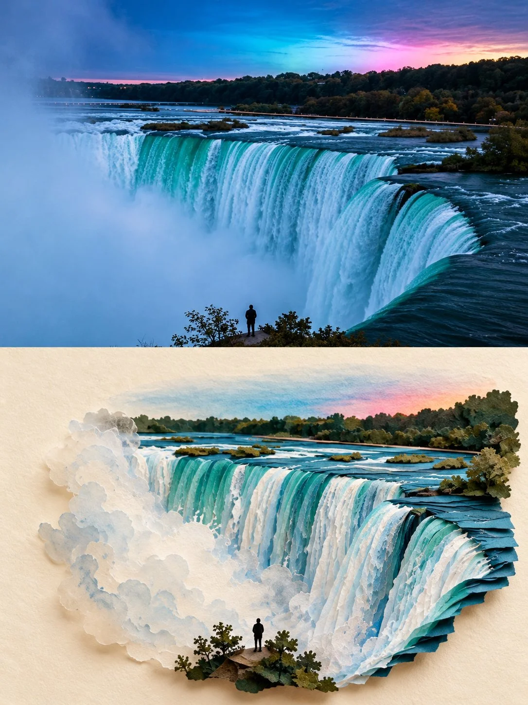

# “Second World” Photo + Paper-Art Split Poster

**中文标题：** “第二世界”照片+纸艺分屏海报  
**ID:** `gi25-x-926` · **Mode:** `generate`  
**Categories:** `poster-typography`, `edit-change-preserve`  
**Tags:** `x-twitter`, `community`, `gpt-image-2.5`, `x-direct`, `en`



### “Second World” Photo + Paper-Art Split Poster

```text
Create a 3:4 vertical “Second World” photographic art poster using [LOCATION / DESTINATION / SUBJECT] as the sole visual reference.

COMPOSITION:
Divide the canvas into two equal horizontal halves.

TOP HALF — ORIGINAL PHOTOGRAPH:
Preserve the photograph as faithfully as possible, including its subject, gestures, composition, perspective, colors, and natural lighting. Allow only necessary proportional cropping and subtle color correction. Do not redesign the scene.

BOTTOM HALF — THE SECOND WORLD:
Use a warm ivory paper background with generous negative space. Study the photograph’s most distinctive visual feature—such as water, reflections, shadows, roads, architectural edges, light, or human movement—and transform it into an imaginative miniature world that grows naturally from the image itself.

CREATIVE INTERPRETATION:
Let the photograph’s shapes and contours inspire the paper construction and visual narrative. Create an original, location-specific concept using refined paper-cut layers, subtle folds, tactile materials, realistic depth, and delicate shadows. Introduce miniature objects or tiny figures only when they meaningfully enhance the idea. Avoid generic templates and unnecessary decoration.

VISUAL STYLE:
A sophisticated fusion of authentic photography, handcrafted paper art, and miniature spatial storytelling. Maintain believable perspective, understated elegance, and poetic visual connections between the two halves.

The lower scene must feel uniquely derived from the photograph, not like a simple copy, random collage, or conventional pop-up book.

Avoid excessive fantasy, distorted subjects, unrelated props, watercolor filters, clutter, titles, readable text, borders, and watermarks.

FORMAT: 3:4 vertical, precise 50/50 horizontal division.
```

- **Recommended model:** `gpt-image-2.5-sunburst`
- **Settings:** _(defaults)_
- **Source:** [community](https://x.com/Goodmanprotocol/status/2112052767430942770) — @Goodmanprotocol
- **License note:** Original public X post; quoted with attribution — remix with attribution
- **Notes:** Collected directly from X; original post https://x.com/Goodmanprotocol/status/2112052767430942770; post text names GPT Image 2.5; discovered via X search, prompt re-verified against the original X post via api.fxtwitter.com; verified=True
- **Preview:** `previews/gi25-x-926.webp`
