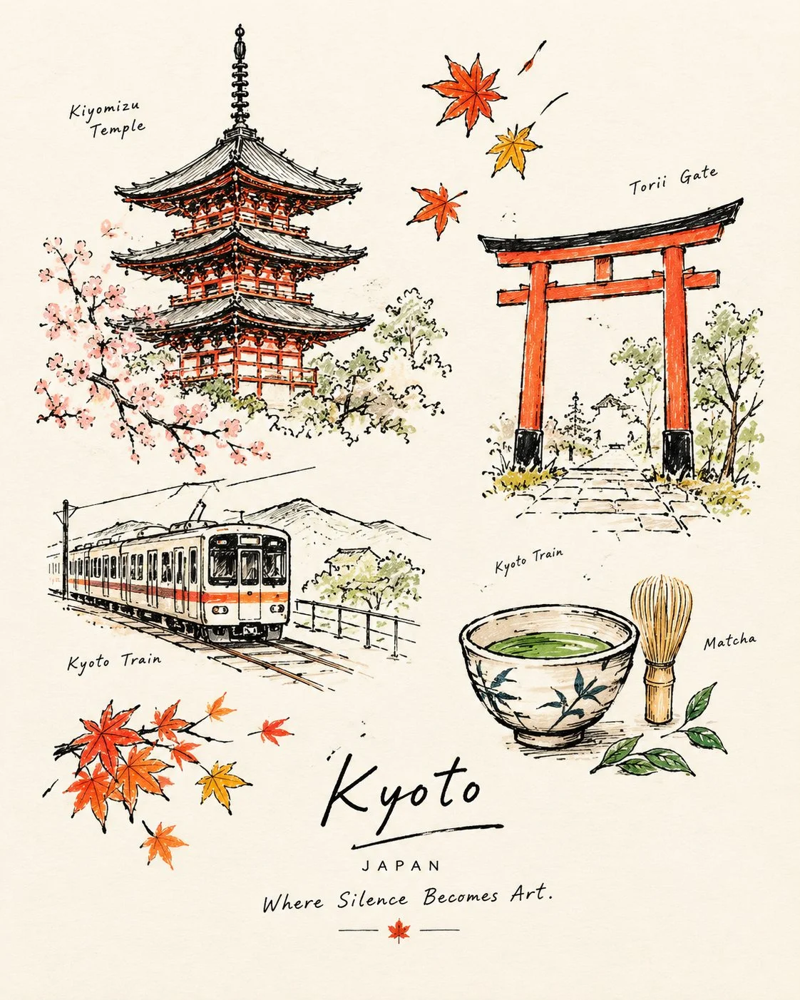

# Japanese-Ink Travel Doodle Postcard Template

**中文标题：** 日式墨线旅行涂鸦明信片模板  
**ID:** `gi25-x-927` · **Mode:** `generate`  
**Categories:** `poster-typography`  
**Tags:** `x-twitter`, `community`, `gpt-image-2.5`, `x-direct`, `en`



### Japanese-Ink Travel Doodle Postcard Template

```text
Create a beautiful, minimalist hand-drawn travel journal illustration inspired by the charm of vintage Japanese ink sketches and modern editorial travel art.
Feature [CITY / COUNTRY / LANDMARK] through 4–5 small, thoughtfully arranged doodles, each representing a unique part of its identity. Use loose black ink outlines, imperfect sketchbook strokes, delicate hatching, and selective pops of beautiful colors against a warm ivory-white background.
Include these elements:
One iconic landmark as the main illustration.
One traditional street, architectural detail, or local scene.
One local transport or everyday-life element.
One cultural object, traditional food, or drink.
Tiny flowers, leaves, birds, or other delicate decorative details.
Typography and layout: Write the name of the city or country in elegant, handwritten lettering near the bottom. Add a short, poetic tagline underneath that captures the soul of the place.
Include tiny handwritten labels beside selected illustrations, identifying the objects or landmarks with just 1–3 words each.
Use a restrained palette of black ink, warm rust orange, muted terracotta, soft sage green, and occasional golden-yellow accents. Leave generous negative space. Some elements should remain simple black-and-white sketches, while a few are filled with beautiful, rich yet tasteful colors.
The final result should feel intimate, artistic, nostalgic, and effortlessly beautiful—a collectible travel postcard drawn by someone who fell in love with the place.
Aspect ratio: 4:5, portrait composition. No photorealism, no 3D, no clutter, no heavy backgrounds, no excessive text.
```

- **Recommended model:** `gpt-image-2.5-sunburst`
- **Settings:** _(defaults)_
- **Source:** [community](https://x.com/Naiknelofar788/status/2112051311856504985) — @Naiknelofar788
- **License note:** Original public X post; quoted with attribution — remix with attribution
- **Notes:** Collected directly from X; original post https://x.com/Naiknelofar788/status/2112051311856504985; post text names GPT Image 2.5; discovered via X search, prompt re-verified against the original X post via api.fxtwitter.com; verified=True
- **Preview:** `previews/gi25-x-927.webp`
