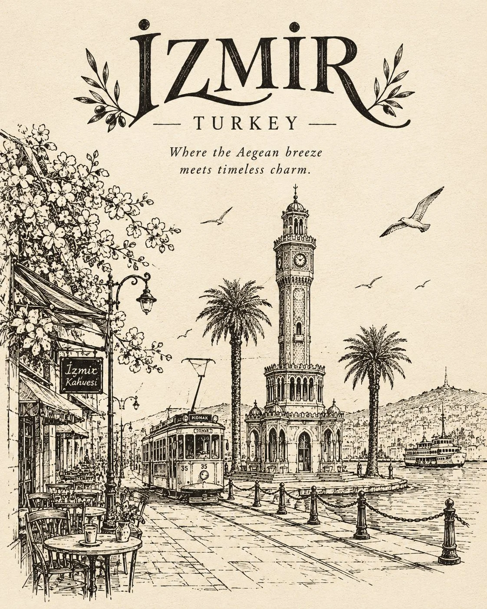

# Vintage Hand-Drawn Landmark Travel Sketch Template

**中文标题：** 复古手绘地标旅行速写模板  
**ID:** `gi25-x-944` · **Mode:** `generate`  
**Categories:** `poster-typography`  
**Tags:** `x-twitter`, `community`, `gpt-image-2.5`, `x-direct`, `en`



### Vintage Hand-Drawn Landmark Travel Sketch Template

```text
Create a beautiful, vintage-inspired hand-drawn architectural illustration of [LANDMARK], [CITY], [COUNTRY], inspired by the charm of old travel sketchbooks and traditional pen-and-ink drawings.

Composition: Feature the most iconic landmark of [CITY] as the main subject, surrounded by authentic local architecture, historic buildings, charming streets, traditional transportation, vintage street signs, overhead wires, and small cultural details that make the place instantly recognizable. Include a tram, bicycle, old car, or other local transportation where appropriate.

Art Style: Use delicate black ink linework, expressive hand-drawn strokes, intricate architectural details, fine cross-hatching, imperfect outlines, and an unfinished sketchbook aesthetic. Keep the illustration predominantly monochrome on a clean, warm ivory-white background. Preserve the landmark’s authentic architecture, proportions, and recognizable features.

Typography & Title Design: Make the name of the place the visual highlight of the composition. Add [CITY, COUNTRY] in a beautiful, eye-catching vintage editorial font, such as elegant retro serif lettering, artistic hand-lettered calligraphy, or bold old-world typography. Give the lettering a distinctive personality, with graceful curves, carefully spaced characters, and a timeless travel-poster aesthetic.

Position the title harmoniously at the top or bottom of the illustration, ensuring it is clearly readable and beautifully integrated into the artwork. Make the city name prominent and the country name slightly smaller beneath it. Add subtle decorative flourishes, delicate ink ornaments, or thin vintage borders around the typography. The lettering should feel like a carefully designed title on a collectible travel poster, not ordinary computer text.

Historical Tagline: Beneath the place name, include a short, poetic line that reflects the destination’s history and character, such as:

“Every street remembers. Every stone tells a story.”

Generate a suitable, location-specific tagline for each destination.

Overall Atmosphere: Nostalgic, artistic, authentic, culturally rich, elegant, and timeless. The result should resemble an original illustration from a vintage travel journal, beautifully transformed into a collectible art print.

Color Palette: Primarily black ink on warm ivory paper, with subtle natural paper texture. Keep the composition minimal, airy, and sophisticated.

Avoid: Photorealism, 3D rendering, glossy digital effects, excessive colors, generic architecture, cluttered composition, and plain or poorly rendered typography.

Format: 4:5 portrait composition, high-resolution illustration, balanced negative space, professional editorial layout.

Replace these details for every new artwork:

Landmark: [LANDMARK]
City: [CITY]
Country: [COUNTRY]

The final result should feel like a beautiful vintage illustration with a memorable title—an artwork people would want to save, frame, and collect.
```

- **Recommended model:** `gpt-image-2.5-sunburst`
- **Settings:** _(defaults)_
- **Source:** [community](https://x.com/Naiknelofar788/status/2112760767900778717) — @Naiknelofar788
- **License note:** Original public X post; quoted with attribution — remix with attribution
- **Notes:** Collected directly from X; original post https://x.com/Naiknelofar788/status/2112760767900778717; post text names GPT Image 2.5; discovered via X search, prompt re-verified against the original X post via api.fxtwitter.com; verified=True
- **Preview:** `previews/gi25-x-944.webp`
