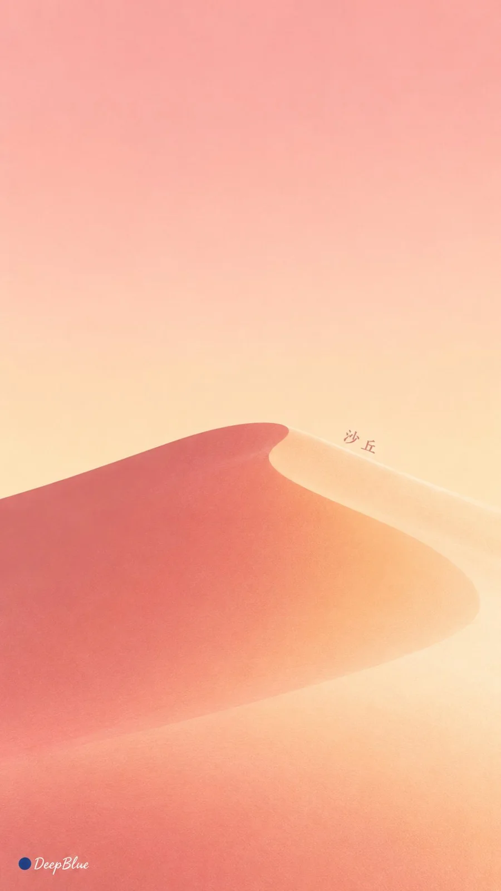

# Split-Fountain Screen-Print Nature Wallpaper (Variant 2/4)

**中文标题：** 同版渐变丝网印刷自然意象壁纸（变体 2/4）  
**ID:** `gi25-x-954` · **Mode:** `generate`  
**Categories:** `poster-typography`, `general`  
**Tags:** `x-twitter`, `community`, `gpt-image-2.5`, `x-direct`, `zh`



### Split-Fountain Screen-Print Nature Wallpaper (Variant 2/4)

```text
主题：Split Fountain 同版渐变丝网印刷 × 自然意象的极简图形化 × 治愈系艺术壁纸

每张独立探索一种自然意象，将其提炼为轮廓鲜明、形态柔和的极简平面图形，以少量完整的大色面与负形表现，保留辨识度和舒展留白。

两种协调而有区分度的油墨在同一张丝网上并排布墨，经刮印形成连续色带。主体两端保留清楚的原色，中间自然交融，混色带宽窄略有变化。渐变贯穿整个主体，各部分共享同一色带关系。

色面平整、哑光，印刷边缘明确而自然，纸纹轻淡。配色柔和清透，主体清楚可辨。

将主体简短、准确的中文名称轻巧融入轮廓或负形关系，文字完整可读，与主体共同构图，视觉分量克制。

以舒展的形态、温润配色和疏密留白呈现治愈感与艺术性。适合手机壁纸，顶部疏朗，主体尺度与位置自然变化。

同批十张主体不同，独立探索配色、渐变方向与图文关系，避免重复布局。

9:16竖版，n=10。十张独立单图，分别输出，不拼图、不合并画布。
左下签名：深蓝色实心圆点在前，白色自然手写体“DeepBlue”在后。
```

- **Recommended model:** `gpt-image-2.5-sunburst`
- **Settings:** _(defaults)_
- **Source:** [community](https://x.com/DeepBlueX0/status/2112574150867083480) — @DeepBlueX0
- **License note:** Original public X post; quoted with attribution — remix with attribution
- **Notes:** Collected directly from X; prompt posted as the author's own reply https://x.com/DeepBlueX0/status/2112574150867083480 (with its own images) in the thread https://x.com/DeepBlueX0/status/2112574010928308548, whose first post names GPT Image 2.5; discovered via X search, prompt re-verified against the original X post via api.fxtwitter.com; verified=True
- **Preview:** `previews/gi25-x-954.webp`
