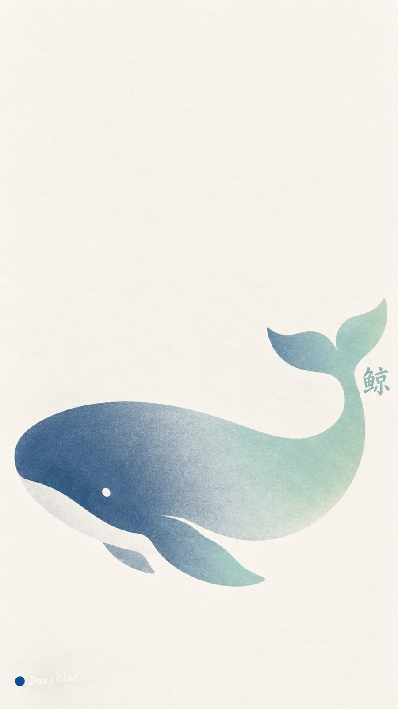

# Split-Fountain Screen-Print Nature Wallpaper (Variant 3/4)

**中文标题：** 同版渐变丝网印刷自然意象壁纸（变体 3/4）  
**ID:** `gi25-x-955` · **Mode:** `generate`  
**Categories:** `poster-typography`, `general`  
**Tags:** `x-twitter`, `community`, `gpt-image-2.5`, `x-direct`, `zh`



### Split-Fountain Screen-Print Nature Wallpaper (Variant 3/4)

```text
主题：Split Fountain 同版渐变丝网印刷 × 自然意象的极简图形化 × 治愈系艺术壁纸

每张独立探索一种自然意象，提炼为轮廓鲜明、形态柔和的极简平面图形，以少量完整色面与负形保留辨识度，构图舒展。

呈现 Split Fountain 同版渐变丝网印刷成品。两种协调而有区分度的油墨沿同一方向自然交融，整个主体共享一道连续色带，两侧原色清楚，中间混色柔和，过渡宽窄略有手工变化。

哑光墨层平整细腻，轮廓明确自然，暖白纸纹隐约可见。配色柔和清透，主体清晰。

主体简短、准确的中文名称参与整体设计，通过字形、字距与位置呼应轮廓、走势或负形。文字完整可读，分量克制，与主体形成自然整体。

以图文比例、疏密和留白呈现艺术感，安静、温暖、轻盈。适合手机壁纸，顶部疏朗，主体尺度与位置灵活变化。

同批十张主体不同，独立探索配色、渐变方向与图文关系，避免重复布局。

9:16竖版，n=10。十张独立单图，分别输出，不拼图、不合并画布。
左下签名：深蓝色实心圆点在前，白色自然手写体“DeepBlue”在后。
```

- **Recommended model:** `gpt-image-2.5-sunburst`
- **Settings:** _(defaults)_
- **Source:** [community](https://x.com/DeepBlueX0/status/2112574175361810883) — @DeepBlueX0
- **License note:** Original public X post; quoted with attribution — remix with attribution
- **Notes:** Collected directly from X; prompt posted as the author's own reply https://x.com/DeepBlueX0/status/2112574175361810883 (with its own images) in the thread https://x.com/DeepBlueX0/status/2112574010928308548, whose first post names GPT Image 2.5; discovered via X search, prompt re-verified against the original X post via api.fxtwitter.com; verified=True
- **Preview:** `previews/gi25-x-955.webp`
