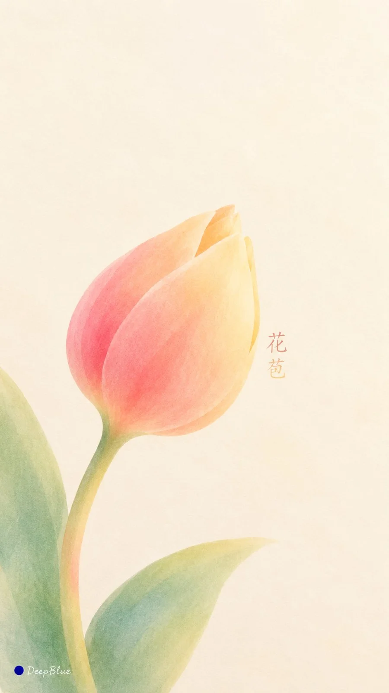

# Split-Fountain Screen-Print Nature Wallpaper (Variant 4/4)

**中文标题：** 同版渐变丝网印刷自然意象壁纸（变体 4/4）  
**ID:** `gi25-x-956` · **Mode:** `generate`  
**Categories:** `poster-typography`, `general`  
**Tags:** `x-twitter`, `community`, `gpt-image-2.5`, `x-direct`, `zh`



### Split-Fountain Screen-Print Nature Wallpaper (Variant 4/4)

```text
主题：治愈系自然意象 × Split Fountain 同版渐变丝网印刷 × 极简艺术壁纸 

每张独立选择一种轮廓鲜明的自然意象，以少量舒展的平面色形表现，形态柔和，细节简练。

柔和而清透的油墨沿统一方向自然交融，连续色带贯穿整个主体，各部分共享同一渐变关系。保留细微混色变化，哑光墨层平整细腻，暖白纸纹隐约可见。

主体简短、准确的中文名称轻巧参与构图，通过字形、字距与位置呼应主体的轮廓或留白。文字完整可读，视觉分量克制，与图形形成自然整体。

以图文比例、疏密和留白呈现艺术感，安静、温暖、轻盈。适合手机壁纸，顶部保持安静舒适，主体尺度与位置灵活变化。

同批十张主体不同，独立探索配色、渐变方向与图文关系，避免重复布局。

9:16竖版，n=10。十张独立单图，分别输出，不拼图、不合并画布。
左下签名：深蓝色实心圆点在前，白色自然手写体“DeepBlue”在后。
```

- **Recommended model:** `gpt-image-2.5-sunburst`
- **Settings:** _(defaults)_
- **Source:** [community](https://x.com/DeepBlueX0/status/2112574187986714629) — @DeepBlueX0
- **License note:** Original public X post; quoted with attribution — remix with attribution
- **Notes:** Collected directly from X; prompt posted as the author's own reply https://x.com/DeepBlueX0/status/2112574187986714629 (with its own images) in the thread https://x.com/DeepBlueX0/status/2112574010928308548, whose first post names GPT Image 2.5; discovered via X search, prompt re-verified against the original X post via api.fxtwitter.com; verified=True
- **Preview:** `previews/gi25-x-956.webp`
