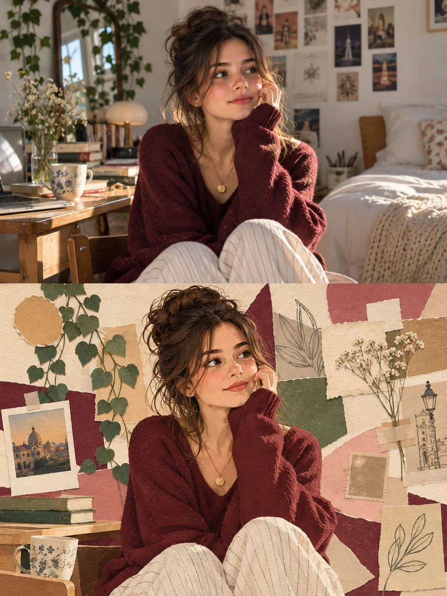

# Photo + Paper-Art 50/50 Split Editorial Poster

**中文标题：** 上下对半照片+纸艺编辑海报  
**ID:** `gi25-x-957` · **Mode:** `generate`  
**Categories:** `poster-typography`  
**Tags:** `x-twitter`, `community`, `gpt-image-2.5`, `x-direct`, `en`



### Photo + Paper-Art 50/50 Split Editorial Poster

```text
Create a premium 3:4 vertical editorial poster with a precise 50/50 horizontal split.

TOP HALF: Ultra-realistic studio photograph of a beautiful young adult woman with dark brown hair in a messy bun, wearing an oversized burgundy knit sweater, cream wide-leg trousers, and delicate gold jewelry. She sits casually beside her bed in a cozy aesthetic bedroom, resting her cheek on one hand and gazing toward a sunlit window. Include wooden furniture, books, indoor plants, framed art, dried flowers, and warm afternoon sunlight. Natural skin texture, cinematic photography, soft shadows, and subtle film grain.

BOTTOM HALF: Reinterpret the same woman, pose, outfit, and bedroom as a handcrafted paper collage. Use layered burgundy, cream, dusty rose, and olive cardstock, torn edges, paper plants, miniature books, a ceramic mug, and abstract geometric shapes. Preserve recognizable features while creating a sophisticated, tactile mixed-media artwork.

STYLE: Minimalist gallery poster, warm nostalgic atmosphere, visible paper fibers, delicate overlapping layers, elegant asymmetry, muted colors, and refined editorial composition. No cartoon style, glossy 3D, excessive shadows, or unnecessary text. Maintain a clear division between authentic photography above and paper art below.
```

- **Recommended model:** `gpt-image-2.5-sunburst`
- **Settings:** _(defaults)_
- **Source:** [community](https://x.com/j_smeaton99/status/2112569181485011355) — @j_smeaton99
- **License note:** Original public X post; quoted with attribution — remix with attribution
- **Notes:** Collected directly from X; original post https://x.com/j_smeaton99/status/2112569181485011355; post text names GPT Image 2.5; discovered via X search, prompt re-verified against the original X post via api.fxtwitter.com; verified=True
- **Preview:** `previews/gi25-x-957.webp`
