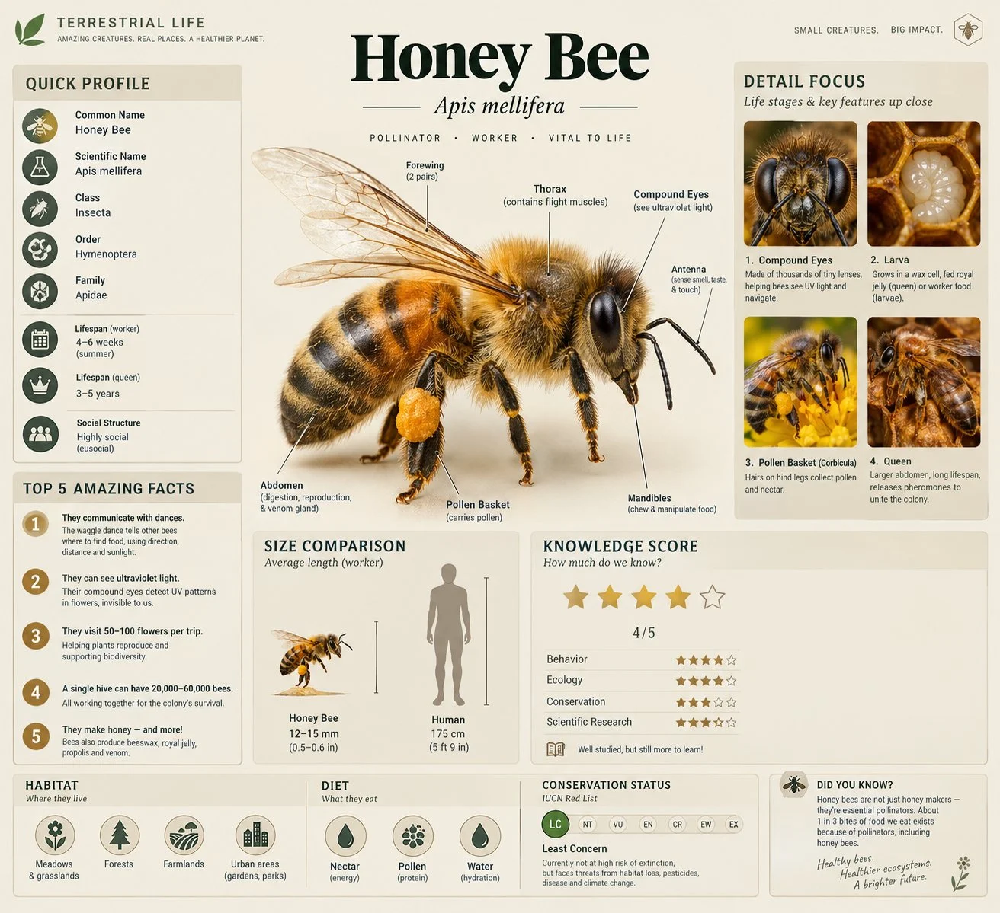

# Terrestrial Life Educational Infographic Template

**中文标题：** “陆地生命”科普信息图模板  
**ID:** `gi25-x-976` · **Mode:** `generate`  
**Categories:** `poster-typography`  
**Tags:** `x-twitter`, `community`, `gpt-image-2.5`, `x-direct`, `en`



### Terrestrial Life Educational Infographic Template

```text
A professional educational infographic for a [Subject], designed in a modern "Terrestrial Life" series style. The layout features a large, realistic 3D central illustration of the [Subject] with anatomical labels like "Compound Eyes," "Thorax," and "Abdomen" using thin pointer lines. The color palette is clean with soft beige and muted tones. The composition includes multiple data modules: a "Quick Profile" sidebar, a "Top 5 Amazing Facts" list, a "Size Comparison" chart against a human silhouette, and a "Knowledge Score" star rating system. Include a "Detail Focus" section on the right with four square macro-photography close-ups of life stages or specific features. The bottom features "Habitat" and "Diet" icons, a "Conservation Status" slider, and a small "Did You Know?" footer. High resolution, crisp typography, clean vector lines, and a professional scientific journal aesthetic.
```

- **Recommended model:** `gpt-image-2.5-sunburst`
- **Settings:** _(defaults)_
- **Source:** [community](https://x.com/iamsofiaijaz/status/2113510238846672945) — @iamsofiaijaz
- **License note:** Original public X post; quoted with attribution — remix with attribution
- **Notes:** Collected directly from X; original post https://x.com/iamsofiaijaz/status/2113510238846672945; post text names GPT Image 2.5; discovered via Bin0754/gpt-image-gallery index, prompt re-verified against the original X post via api.fxtwitter.com; verified=True
- **Preview:** `previews/gi25-x-976.webp`
