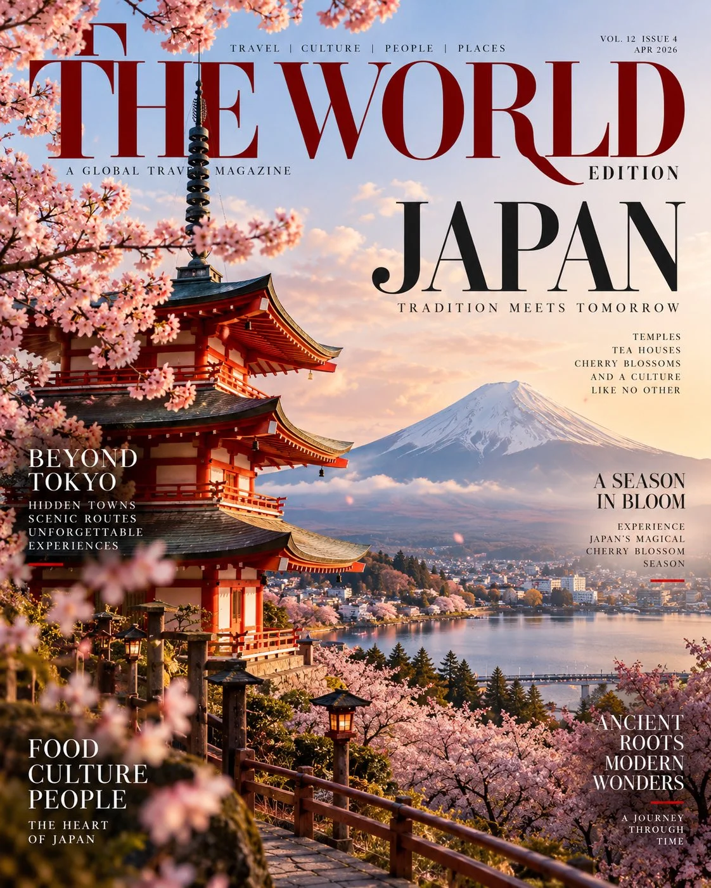

# Premium Travel Magazine Cover Template

**中文标题：** 高端旅行杂志封面模板  
**ID:** `gi25-x-995` · **Mode:** `generate`  
**Categories:** `poster-typography`  
**Tags:** `x-twitter`, `community`, `gpt-image-2.5`, `x-direct`, `en`



### Premium Travel Magazine Cover Template

```text
Create a breathtaking, premium travel magazine cover featuring [CITY / COUNTRY / LANDMARK] as the star of the composition.

Capture the destination through its most iconic architecture, breathtaking landscapes, recognizable landmarks, local culture, traditional details, and distinctive atmosphere. Make the location instantly recognizable while presenting it in a fresh, artistic, editorial style.

Magazine design: Sophisticated international travel magazine, elegant masthead at the top, oversized refined typography, minimal yet striking cover lines, carefully balanced text placement, premium editorial art direction, subtle print texture, and a realistic glossy magazine finish.

Photography: High-end travel photography, cinematic natural lighting, rich yet tasteful colors, realistic textures, atmospheric depth, exquisite details, professional color grading, and an aspirational luxury-travel aesthetic.

Layout: Vertical 4:5 magazine cover, full-bleed hero image, destination name prominently displayed, small editorial headlines around the edges, issue date and subtle cover details. Keep the landmark unobstructed and the typography legible.

The final image should look like an actual internationally acclaimed travel magazine cover, not a tourism poster. Make it visually iconic, sophisticated, photorealistic, and worthy of a collector’s edition.
```

- **Recommended model:** `gpt-image-2.5-sunburst`
- **Settings:** _(defaults)_
- **Source:** [community](https://x.com/Naiknelofar788/status/2114337298292904206) — @Naiknelofar788
- **License note:** Original public X post; quoted with attribution — remix with attribution
- **Notes:** Collected directly from X; original post https://x.com/Naiknelofar788/status/2114337298292904206; post text names GPT Image 2.5; discovered via Bin0754/gpt-image-gallery index, prompt re-verified against the original X post via api.fxtwitter.com; verified=True
- **Preview:** `previews/gi25-x-995.webp`
