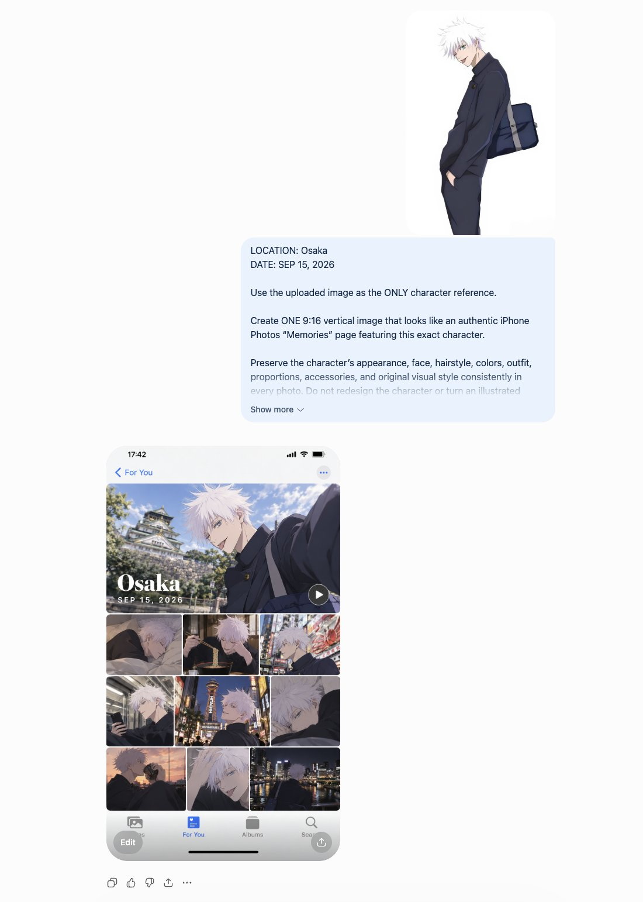

# Character → iPhone Photos 'Memories' Page

**中文标题：** 角色→iPhone 相册「回忆」页面  
**ID:** `gi25-x-708` · **Mode:** `edit`  
**Categories:** `ui-mockup`, `character-consistency`  
**Tags:** `x-twitter`, `community`, `gpt-image-2.5`, `x-direct`, `en`



### Character → iPhone Photos 'Memories' Page

```text
LOCATION: Osaka
DATE: SEP 15, 2026

Use the uploaded image as the ONLY character reference.

Create ONE 9:16 vertical image that looks like an authentic iPhone Photos “Memories” page featuring this exact character.

Preserve the character’s appearance, face, hairstyle, colors, outfit, proportions, accessories, and original visual style consistently in every photo. Do not redesign the character or turn an illustrated character into a real person.

Automatically imagine a believable day of memories that fits the character and their visual world. Create a natural mix of candid photos from morning to night: indoor moments, food or drinks, travel, streets, scenery, sunset, nighttime, and resting. Automatically choose suitable activities, locations, lighting, and atmosphere.

LAYOUT
Authentic Apple Photos Memories aesthetic, 9:16. One large hero memory photo at the top, followed by an organic collage of differently sized photos below. Natural iPhone photo-library spacing and proportions, not a rigid grid. Include subtle iOS Photos interface elements and a play button.

TEXT
English only. Display only the LOCATION and DATE above. No captions, quotes, or decorative text.

Make the photos feel spontaneous and personal rather than staged, with varied framing, close-ups, wide shots, imperfect candid compositions, natural lighting, occasional motion blur, and different times of day. The final result should feel like iPhone Photos automatically created a memory from one real day with this character.
```

- **Recommended model:** `gpt-image-2.5-sunburst`
- **Settings:** _(defaults)_
- **Source:** [community](https://x.com/Mayz1169/status/2099826076759609547) — @Mayz1169
- **License note:** Original public X post; quoted with attribution — remix with attribution
- **Notes:** Collected directly from X; prompt posted as the author's reply https://x.com/Mayz1169/status/2099826076759609547 to https://x.com/Mayz1169/status/2099825335491764544, which carries the images and names GPT Image 2.5; discovered via Bin0754/gpt-image-gallery index, prompt re-verified against the original X post; verified=True
- **Preview:** `previews/gi25-x-708.jpg`
