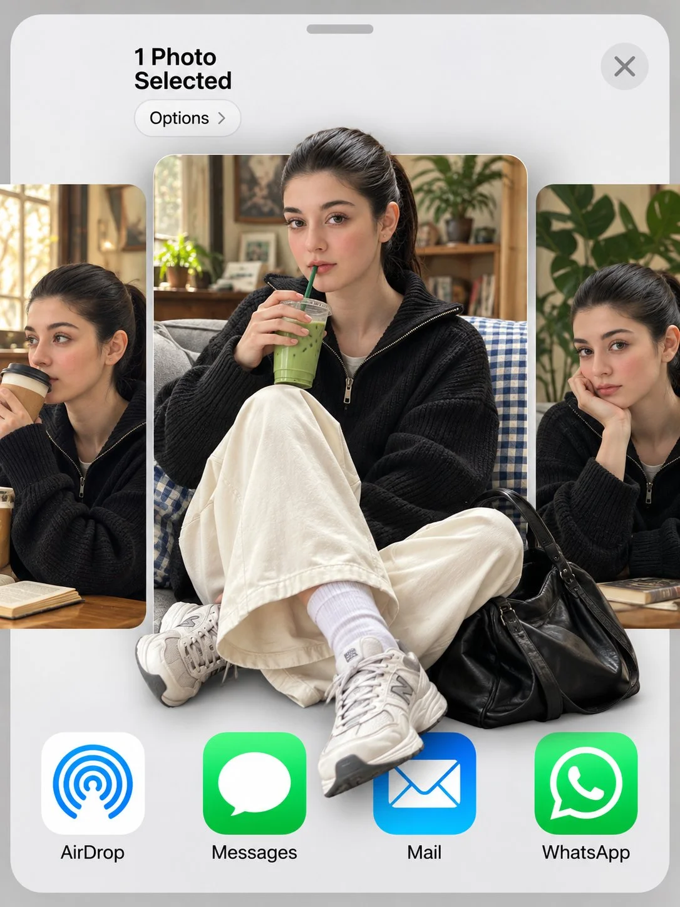

# iOS Share Sheet Photo Carousel Mockup from Face Reference

**中文标题：** 参考人脸→iOS 分享面板照片轮播样机  
**ID:** `gi25-x-749` · **Mode:** `edit`  
**Categories:** `ui-mockup`, `character-consistency`  
**Tags:** `x-twitter`, `community`, `gpt-image-2.5`, `x-direct`, `en`



### iOS Share Sheet Photo Carousel Mockup from Face Reference

```text
Use my uploaded photo as the face reference. 3:4 vertical. An iOS share sheet on a light grey background: top left reads "1 Photo
Selected" with an "Options >" pill below it, a round X close button top right, then a horizontal carousel of three photo thumbnails, and a
bottom row of app icons labeled "AirDrop", "Messages", "Mail", "WhatsApp". Center thumbnail: the man in reference, keeping his exact
face, hairstyle and identity, sitting cross-legged on a grey couch with a blue gingham blanket, holding an iced matcha latte with a green
straw, looking at the camera. He wears a black baseball cap with a white NY logo, thin round gold wire glasses, an oversized cream shirt
with a grey knit sweater draped over his shoulders, wide black trousers, white socks and black leather penny loafers, with a red crochet
drawstring bag at his feet. 3D pop-out effect: his cap breaks out above the thumbnail's top edge, and his loafers and the red bag spill out
over the app icons below. Side thumbnails, partially cropped: the same man sipping a takeaway coffee on the left, and resting his chin on
his hand beside a monstera plant on the right. Soft indoor daylight, realistic skin texture.
```

- **Recommended model:** `gpt-image-2.5-sunburst`
- **Settings:** _(defaults)_
- **Source:** [community](https://x.com/TheVirtualMuse/status/2109582485147517056) — @TheVirtualMuse
- **License note:** Original public X post; quoted with attribution — remix with attribution
- **Notes:** Collected directly from X; original post https://x.com/TheVirtualMuse/status/2109582485147517056; post text names GPT Image 2.5; discovered via Bin0754/gpt-image-gallery index, prompt re-verified against the original X post via api.fxtwitter.com; verified=True
- **Preview:** `previews/gi25-x-749.webp`
